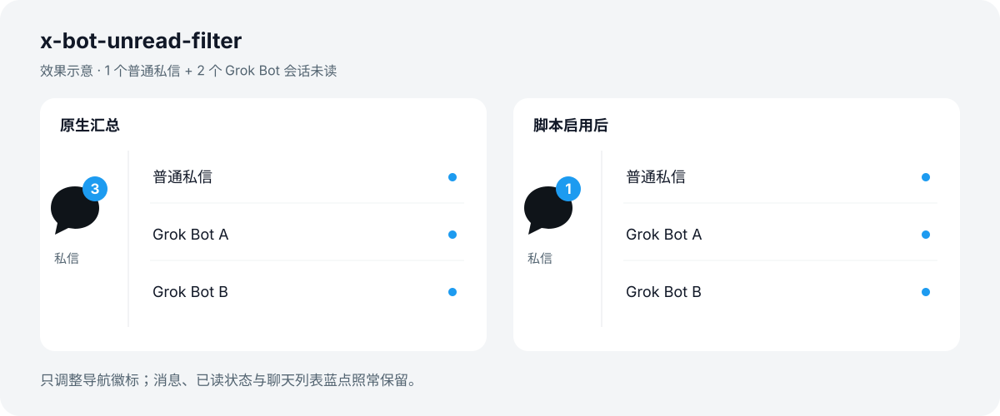

# x-bot-unread-filter

从 X 左侧“私信”未读徽标中排除 **Grok Bot**，保留普通私信提醒。bot 会话在聊天列表中的未读蓝点保持原样。

**网页用户脚本 · MIT · Brave 桌面版已验证**



上图为虚构数据示意，不包含真实会话。脚本仅调整导航徽标及其无障碍标签，不改变浏览器标签页标题。

## 安装

**[从 Greasy Fork 安装](https://greasyfork.org/zh-CN/scripts/605054)** · [English install page](https://greasyfork.org/en/scripts/605054)

备用：[从 GitHub Raw 安装](https://raw.githubusercontent.com/MrEasonYang/x-bot-unread-filter/main/x-human-dm-badge.user.js)。

1. 从 [Tampermonkey 官方网站](https://www.tampermonkey.net/)安装对应浏览器扩展。
2. 在扩展详情中开启 **Allow User Scripts / 允许用户脚本**。新版 Chromium 浏览器需要这一步，见 [官方说明](https://www.tampermonkey.net/faq.php?locale=en&q=Q209)。
3. 打开安装链接，在 Tampermonkey 页面检查名称和运行范围 `https://x.com/*`，点击安装。
4. 将 Tampermonkey 的站点访问限制为 `x.com`，刷新 X。

也可以在 Tampermonkey 的 Utilities → Import from file 中导入 `x-human-dm-badge.user.js`。

停用或删除这个脚本并刷新 X，即可恢复原生显示。安装和使用都不需要提供 X 账号、密码或 API Key。

## 功能范围

- 仅作用于 `x.com` 网页的“私信”导航徽标。
- bot 消息继续接收；聊天列表里的未读蓝点继续显示。
- 普通私信使用 X 自己的独立计数，不通过减去屏幕上可见的 bot 条目来估算，因此不依赖聊天列表的加载进度。
- “bot”特指 X 的 **Grok Bot 会话**。普通 X 账号里的自动回复、营销号或垃圾私信仍按普通私信计数；脚本不识别对方是不是真人。
- 不控制系统推送、手机通知、浏览器标签页标题，也不作用于 X 手机 App。

## 数据与权限

脚本没有网络请求、外部运行依赖、持久化存储或日志。它从页面现有的 React Provider 订阅状态，只读取 `badgeCount` 下的普通私信计数字段，再修改导航徽标。

它不读取消息正文、Cookie 或认证信息，不发送消息，不标记已读，也不修改 X 的应用状态。脚本需要在页面主环境运行（`@sandbox raw`）；`@grant none` 并不代表无法访问页面内容，因此源码保持可读，供使用者检查。

## 兼容性与限制

- 已验证：macOS Brave + Tampermonkey 5.5.1，包含刷新自动运行、bot 单独未读、页内导航和停用恢复。
- 普通私信与 bot 混合计数通过自动测试；尚未验收真实真人新消息到达的完整链路。
- 其他浏览器和脚本管理器暂未实测，不承诺兼容。
- X 的内部页面结构和计数字段可能变化。脚本识别失败或遇到无效计数时，会保留或恢复 X 的原生提醒。
- 超过 99 个普通未读会话时，徽标显示 `99+`，无障碍标签保留实际数值。

## 更新与反馈

从 GitHub 安装的版本通过脚本内的 `@updateURL` / `@downloadURL` 检查更新；从 Greasy Fork 安装的版本由 Greasy Fork 提供更新。是否自动安装更新取决于你的 Tampermonkey 设置。

发现异常可提交 [GitHub Issue](https://github.com/MrEasonYang/x-bot-unread-filter/issues)，说明浏览器、Tampermonkey 版本和现象即可。请勿附上私信正文、账号凭证或未处理的诊断日志。

这是非官方项目，与 X、xAI 或 Tampermonkey 无隶属关系。

## 开发

```sh
npm ci --ignore-scripts
npm test
npm run prepare-release
```

运行时只有一个 `.user.js` 文件；npm 依赖仅用于开发测试。`prepare-release` 生成更新元数据文件和本地发布包，不上传任何文件。

测试覆盖 bot 单独未读、混合计数、远端回退、无效字段契约、SPA 导航重建、徽标替换、订阅更新和停用恢复。

## English

Exclude Grok Bot conversations from X's navigation DM unread badge while keeping ordinary DM alerts and bot conversation unread dots. Desktop Brave with Tampermonkey 5.5.1 has been verified; other browsers are untested. This script does not detect automated ordinary X accounts, mark messages as read, change push notifications, or run inside the X mobile apps.

Install Tampermonkey, allow user scripts, install the `.user.js`, grant access only to `x.com`, and reload X. No X credentials or API keys are needed. MIT licensed; unofficial and unaffiliated with X or xAI.
